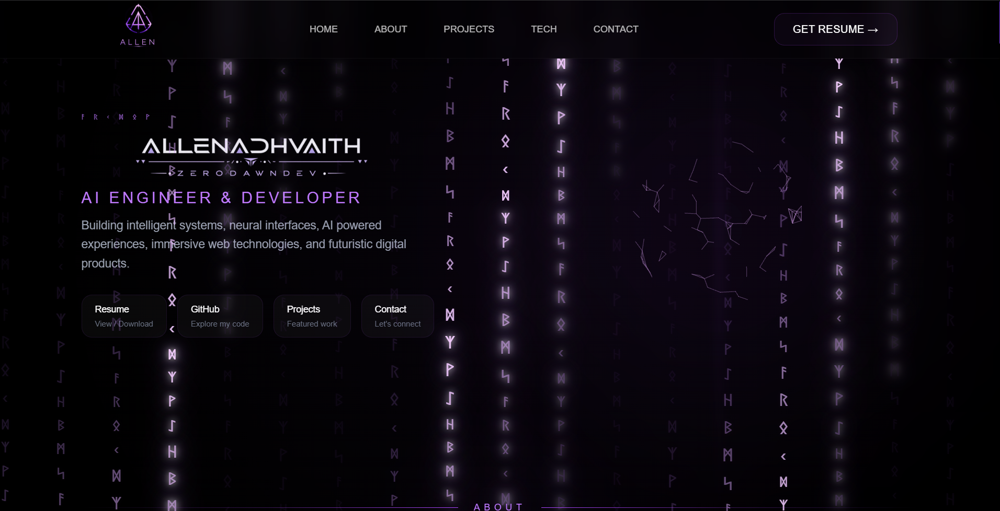

 <div align="center">



# ZERO DAWN

### Intelligent Systems · Research · Engineering


<br />

[](https://zero-touch-sand.vercel.app/)
[](https://github.com/ZeroDawnDev)
[](https://nextjs.org/)
[](https://www.typescriptlang.org/)

</div>

---

## `01 / Overview`

**ZeroDawn** is a personal portfolio and research platform documenting my work across Artificial Intelligence, software engineering, intelligent systems, and experimental architectures.

Designed as more than a conventional portfolio, ZeroDawn presents projects and research through an interactive, systems-inspired interface—reflecting an interest in the architecture behind intelligent software.

> **Build systems. Explore intelligence. Engineer the future.**

---

## `02 / About`

I'm **Allen Adhvaith**, a Computer Science and Engineering graduate currently pursuing a Master's degree in Artificial Intelligence in Kyoto, Japan.

My work and interests center around:

- Artificial Intelligence and intelligent systems
- Multi-agent architectures
- Reinforcement learning
- Autonomous agents
- Neural network optimization
- Knowledge distillation and model compression
- AI infrastructure and system design

My long-term direction is to engineer systems that can reason, learn, adapt, coordinate, and execute—not simply respond.

---

## `03 / Systems Lab`

The Systems Lab presents selected architectures and research projects.

### GAIA — Artificial Intelligence Organism

An experimental modular AI architecture exploring the infrastructure of an intelligent system.

**Areas of exploration**

- Modular subordinate agents
- Task dispatch and orchestration
- Shared state and execution context
- Memory systems
- Knowledge and reasoning components
- Coordinated task execution

### Neural Algorithm Distiller (NAD)

An experimental neural-network optimization pipeline combining reinforcement learning and knowledge distillation.

**Research components**

- Teacher–student learning
- Knowledge distillation
- Structured model pruning
- Reinforcement-learning-based optimization
- Neural architecture exploration
- Compression and efficiency evaluation

---

## `04 / Portfolio Modules`

| Module | Purpose |
|---|---|
| **Hero** | ZeroDawn identity and research direction |
| **About** | Background, education, mission, and profile |
| **Systems Lab** | Interactive architecture presentations |
| **Research & Experiments** | Research notes and technical explorations |
| **Featured Projects** | Selected software and AI projects |
| **GitHub Contributions** | Development activity and open-source work |
| **Tech Stack** | Tools, frameworks, and technologies |
| **Contact** | Collaboration and professional contact |

---

## `05 / Tech Stack`

<div align="center">

### Frontend & Frameworks


### UI & Motion


### Tools & Integration


</div>

---

## `06 / Design System`

ZeroDawn's visual identity is inspired by research interfaces, computational systems, and futuristic engineering environments.

- Dark, high-contrast interface
- Purple and blue accent colors
- Glassmorphism and translucent surfaces
- Neural-inspired background visuals
- Subtle motion and interaction
- Modular components
- Responsive layouts
- System-inspired information panels

---
```text
## `07 / Project Structure`

ZeroDawn/
├── app/
│   ├── page.tsx
│   ├── layout.tsx
│   └── globals.css
├── public/
│   ├── profile/
│   ├── images/
│   ├── assets/
│   └── readme/
│       └── zerodawn-banner.png
├── components/
│   ├── background/
│   ├── layout/
│   ├── hero/
│   ├── about/
│   ├── systems/
│   ├── research/
│   ├── projects/
│   ├── github/
│   ├── techstack/
│   └── contact/
├── lib/
├── package.json
└── README.md
```
*The structure is representative and may change as the project evolves.*


------------------------------------------------------------------------
09 / Development Philosophy
The portfolio is built with a modular component architecture, allowing sections and system presentations to evolve independently.

Development priorities:
- Modularity — isolate components and responsibilities
- Clarity — make technical work understandable
- Functionality — favor real data and meaningful interactions
- Consistency — maintain a coherent design system
- Responsiveness — support desktop and mobile layouts
- Iteration — continuously refine implementation and performance
## `10 / Roadmap`

-   [x] Portfolio foundation
-   [x] Hero section
-   [x] About section
-   [x] Systems Lab
-   [x] GAIA architecture presentation
-   [x] Neural Algorithm Distiller presentation
-   [x] Research & Experiments section
-   [x] Featured Projects section
-   [x] GitHub integration refinement
-   [x] Tech Stack section
-   [x] Contact section
-   [ ] Mobile refinement
-   [ ] Performance and accessibility improvements

------------------------------------------------------------------------

## `11 / Connect`

<div align = "center">
Allen Adhvaith
AI Research · Software Engineering · Intelligent Systems

[](https://github.com/ZeroDawnDev)

</div>


<div align="center">
 ZERO DAWN
Intelligent Systems · Research · Engineering
</div>

